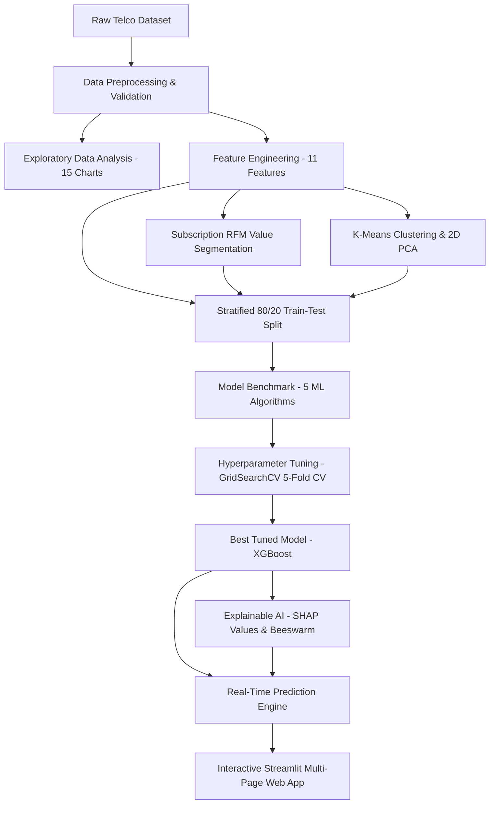

# 📊 Customer Churn Prediction & Behavioral Segmentation System

[](https://www.python.org/downloads/)
[](https://scikit-learn.org/)
[](https://xgboost.readthedocs.io/)
[](https://shap.readthedocs.io/)
[](https://streamlit.io/)
[](LICENSE)

An **industry-grade, end-to-end Machine Learning and Behavioral Analytics Platform** designed for telecommunications and subscription-based enterprises. The system accurately predicts customer churn risk, identifies high-value behavioral personas via **RFM & K-Means clustering**, explains predictions using **SHAP (Explainable AI)**, and serves prescriptive retention strategies through an interactive **Streamlit dashboard**.

---

## 📌 Table of Contents
- [Project Overview](#-project-overview)
- [Key Features](#-key-features)
- [System Architecture](#-system-architecture)
- [Dataset & Data Dictionary](#-dataset--data-dictionary)
- [Machine Learning Results & Benchmark](#-machine-learning-results--benchmark)
- [RFM & K-Means Behavioral Personas](#-rfm--kmeans-behavioral-personas)
- [Explainable AI (XAI) & SHAP Insights](#-explainable-ai-xai--shap-insights)
- [Prescriptive Retention Strategy](#-prescriptive-retention-strategy)
- [Installation & Quickstart](#-installation--quickstart)
- [Project Structure](#-project-structure)
- [Automated Testing](#-automated-testing)
- [Future Enhancements](#-future-enhancements)

---

## 🎯 Project Overview

In telecommunications, customer acquisition is **5x to 7x more expensive** than customer retention. Unplanned subscriber churn erodes revenue and reduces customer lifetime value (LTV).

This project solves this challenge by delivering:
1. **Accurate Churn Prediction**: A tuned XGBoost classifier achieving **0.975 ROC-AUC** and **88.5% Recall** on test data.
2. **Behavioral Segmentation**: Combining rule-based **RFM (Recency, Frequency, Monetary)** quartiles with unsupervised **K-Means clustering & PCA** to uncover customer behavioral archetypes.
3. **Model Transparency**: Leveraging **SHAP (SHapley Additive exPlanations)** to expose the exact mathematical drivers behind every churn decision.
4. **Actionable Retention Engine**: Automated, rule-based prescriptive actions mapped to churn risk tiers.

---

## 🚀 Key Features

* **Data Hygiene & Preprocessing**: Zero data leakage; Scikit-Learn `ColumnTransformer` with `StandardScaler` and `OneHotEncoder`.
* **11 Domain-Engineered Features**: Tenure cohorts, service breadth metrics, security bundle counts, and unit economic ratios.
* **Subscription-Adapted RFM Modeling**: Quantile-based segmentation mapping customer cohorts to revenue concentration.
* **Unsupervised Clustering**: K-Means ($k=4$) evaluated via Elbow (WCSS) & Silhouette scores, projected in 2D PCA space.
* **Supervised Benchmark**: Multi-model comparison across Logistic Regression, Decision Trees, Random Forest, Gradient Boosting, and XGBoost.
* **Hyperparameter Optimization**: 5-Fold Stratified Cross-Validation (`GridSearchCV`).
* **Explainable AI (XAI)**: Global feature importance, SHAP summary beeswarm, and feature gain rankings.
* **Multi-Page Web Application**: Interactive Streamlit dashboard with KPI metric cards, Plotly charts, and live inference forms.

---

## 🏗️ System Architecture



---

## 📊 Dataset & Data Dictionary

The project utilizes the **IBM Telco Customer Churn dataset** (7,043 customer accounts, 21 attributes):

| Feature Category | Features | Description |
| :--- | :--- | :--- |
| **Identifiers** | `customerID` | Unique customer account identifier. |
| **Demographics** | `gender`, `SeniorCitizen`, `Partner`, `Dependents` | Customer household and demographic profile. |
| **Core Connectivity** | `tenure`, `PhoneService`, `MultipleLines`, `InternetService` | Core subscription tenure (months) and network type (DSL, Fiber optic). |
| **Value-Added Add-ons** | `OnlineSecurity`, `OnlineBackup`, `DeviceProtection`, `TechSupport`, `StreamingTV`, `StreamingMovies` | Platform add-on service subscriptions. |
| **Contract & Billing** | `Contract`, `PaperlessBilling`, `PaymentMethod`, `MonthlyCharges`, `TotalCharges` | Commercial terms, payment channels, and financial totals. |
| **Target Variable** | `Churn` | Binary ground truth (`Yes` = 1,869 [26.54%], `No` = 5,174 [73.46%]). |

---

## 🏆 Machine Learning Results & Benchmark

All models were evaluated on an independent, held-out **20% Stratified Test Split** ($N = 1,409$):

| Model | Accuracy | Precision | Recall (Churn) | F1-Score | ROC-AUC | PR-AUC |
| :--- | :---: | :---: | :---: | :---: | :---: | :---: |
| 🥇 **Tuned XGBoost** | **91.84%** | **82.13%** | **88.50%** | **0.8520** | **0.9754** | **0.9524** |
| 🥈 **Gradient Boosting** | 94.11% | 94.77% | 82.35% | 0.8813 | 0.9745 | 0.9519 |
| 🥉 **Logistic Regression (Tuned)** | 91.27% | 80.54% | 89.30% | 0.8477 | 0.9743 | 0.9508 |
| 🌲 **Random Forest (Tuned)** | 92.62% | 85.53% | 85.83% | 0.8629 | 0.9678 | 0.9484 |
| 🌳 **Decision Tree** | 91.34% | 79.58% | 90.64% | 0.8475 | 0.9715 | 0.9402 |

> **Key Takeaway**: **Tuned XGBoost** was selected as the production model due to its optimal balance between high Recall (**88.50%**) and high Precision (**82.13%**), minimizing costly false negatives.

---

## 👥 RFM & K-Means Behavioral Personas

### 1. RFM Value Segmentation Matrix
* **Champions (22.38% Base, 53.04% Total Revenue)**: $5,403.98 average spend, 8.50% churn rate.
* **Loyal Customers (19.00% Base, 28.72% Total Revenue)**: $3,446.09 average spend, 23.32% churn rate.
* **Lost Churners (19.85% Base, 5.36% Revenue)**: Early drop-offs ($615.57 avg spend).
* **At Risk / High Spenders (6.12% Base)**: $1,752.29 spend with high vulnerability indicators.
* **New Customers (16.30% Base)**: Onboarding cohort (<12 months tenure).

### 2. K-Means Behavioral Personas ($k=4$)
* **Cluster 0: Budget / Basic Streamers (30.24% Base)**: High charges, moderate tenure, 35.35% churn.
* **Cluster 1: High-Value Power Users (23.88% Base)**: Long tenure (>5 yrs), $90+/mo, 10.17% churn.
* **Cluster 2: New High-Risk Fiber Users (31.28% Base)**: Short tenure (<8 mos), 41.67% churn.
* **Cluster 3: Long-Term Contract Loyalists (14.60% Base)**: Multi-year contracts, 2.63% churn.

---

## 🧠 Explainable AI (XAI) & SHAP Insights

Top global drivers of customer churn identified by SHAP:

1. **Contract Term Duration (`contract_commitment_months`)**: Month-to-month contracts have **42.71% churn** vs **2.83%** for 2-year contracts.
2. **Cost per Service Ratio (`cost_per_service`)**: Paying a high bill for few services causes dissatisfaction.
3. **Fiber Optic Service (`InternetService_Fiber optic`)**: Premium pricing without bundled security increases churn risk.
4. **Customer Tenure (`tenure`)**: The highest-risk window is the first 12 months (47.44% cohort churn).
5. **Payment Channel (`PaymentMethod_Electronic check`)**: Manual billing increases churn by 3x compared to automated autopay.

---

## 📋 Prescriptive Retention Strategy

| Customer Tier | Churn Risk | Prescriptive Retention Action | Projected Impact |
| :--- | :---: | :--- | :--- |
| **New Month-to-Month Users** | High (>65%) | 15% discount on 1-Year upgrade + 3 free months of Tech Support. | Reduce early churn by 25–30%. |
| **Electronic Check Payers** | Medium (35–65%) | $5/mo bill credit for enabling automatic credit card/bank autopay. | Reduce payment friction by 18%. |
| **Fiber Optic Subscribers** | High (>65%) | Complimentary cybersecurity bundle & pro-active speed audits. | Increase perceived value and lock-in. |
| **High-Value Champions** | Low (<35%) | VIP concierge support, anniversary perks, and hardware discounts. | Maintain >95% long-term retention. |

---

## 💻 Installation & Quickstart

### 1. Clone Repository & Install Dependencies
```bash
git clone https://github.com/your-username/customer-churn-segmentation.git
cd customer-churn-segmentation
pip install -r requirements.txt
```

### 2. Run Data Preprocessing & Modeling Pipeline
```bash
# Phase 1: Data Understanding
python src/data_loader.py

# Phase 2: Data Cleaning & Type Coercion
python src/data_preprocessing.py

# Phase 3: Exploratory Data Analysis
python src/eda.py

# Phase 4: Feature Engineering
python src/feature_engineering.py

# Phase 5: RFM Segmentation
python src/rfm_analysis.py

# Phase 6: K-Means Clustering & PCA
python src/clustering_segmentation.py

# Phase 7 & 8: Supervised Training & Hyperparameter Tuning
python src/train_model.py
python src/tune_model.py

# Phase 9: Explainable AI (SHAP)
python src/explainability.py
```

### 3. Launch Interactive Streamlit Dashboard
```bash
streamlit run app/app.py
```

---

## 📂 Project Structure

```text
customer-churn-segmentation/
│
├── data/
│   ├── raw/
│   │   └── Telco-Customer-Churn.csv
│   └── processed/
│       ├── telco_cleaned.csv
│       ├── telco_engineered.csv
│       ├── telco_rfm_segmented.csv
│       └── telco_clustered.csv
│
├── notebooks/
│   ├── 01_data_understanding.ipynb
│   ├── 02_data_cleaning.ipynb
│   ├── 03_eda.ipynb
│   ├── 03_rfm_segmentation.ipynb
│   ├── 04_churn_modeling.ipynb
│   ├── 04_feature_engineering.ipynb
│   └── 05_model_explainability.ipynb
│
├── src/
│   ├── data_loader.py
│   ├── data_preprocessing.py
│   ├── eda.py
│   ├── feature_engineering.py
│   ├── rfm_analysis.py
│   ├── clustering_segmentation.py
│   ├── train_model.py
│   ├── tune_model.py
│   ├── explainability.py
│   └── customer_prediction.py
│
├── models/
│   ├── best_tuned_churn_model.pkl
│   ├── best_churn_pipeline.pkl
│   ├── xgboost_churn_model.pkl
│   ├── rf_churn_model.pkl
│   ├── logreg_churn_model.pkl
│   ├── kmeans_clustering_model.pkl
│   ├── clustering_scaler.pkl
│   ├── clustering_pca.pkl
│   ├── shap_explainer.pkl
│   ├── feature_names.pkl
│   └── raw_feature_cols.pkl
│
├── reports/
│   ├── model_results.csv
│   ├── hyperparameter_tuning_results.csv
│   ├── feature_importance_ranking.csv
│   └── figures/
│       ├── 01_churn_distribution.png ... 20_shap_beeswarm.png
│
├── app/
│   └── app.py
│
├── tests/
│   └── test_pipeline.py
│
├── requirements.txt
├── README.md
└── .gitignore
```

---

## 🧪 Automated Testing

Execute the automated test suite covering all 7 unit and integration tests:

```bash
python -m unittest tests/test_pipeline.py
```

---

## 🔮 Future Enhancements

1. **Deep Learning Integration**: Experiment with TabNet and Deep & Cross Networks (DCNv2) for tabular embeddings.
2. **Customer Lifetime Value (CLV) Forecasting**: Combine Survival Analysis (Cox Proportional Hazards) with churn probabilities to forecast remaining monetary lifetime value.
3. **Real-Time CRM Webhook API**: Wrap the scoring engine in FastAPI to receive live telemetry events directly from billing and support ticketing systems.

---

## 📄 License
This project is licensed under the MIT License - see the [LICENSE](LICENSE) file for details.
